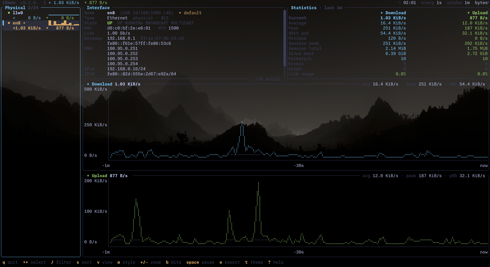

# ifmon - Interface Monitor

> A beautiful, feature-rich terminal network interface monitor built with Rust and [ratatui](https://ratatui.rs/).

[](https://crates.io/crates/ifmon)




## Features

**Dashboard**

- 📈 **Live graphs** for download and upload with a scrolling time axis, dotted average line and readable, auto-scaling axes
- 🧭 **Three views** (split, combined, packets/s) and **four styles** (braille, block, bars, dots)
- 🔍 **Zoom** the time window from 10 seconds to 30 minutes (`+`/`-` or the mouse wheel over a graph)
- 📊 **Statistics panel** with current, average, peak, 95th percentile and minimum over the window, plus session peak, session total, total since boot, packets/s, errors, drops and link utilization
- 🧾 **Interface details**: type, state and flags, MAC, MTU, link speed, default route, gateway, DNS servers and every IPv4/IPv6 address
- 📡 **Sidebar** with status dots, a default-route marker ★, live sparklines and rates for each interface
- 🧠 **History for every interface**, so switching interfaces never resets a graph
- 🔌 **Hot-plug aware**: new adapters, removed adapters and address changes show up automatically
- 🔎 **Filter** by name (`/`), **sort** by name, RX, TX or total (`s`), toggle bits/bytes (`b`)
- ⏸ **Pause** the display while sampling continues, **reset** session stats, **export** history to CSV
- 🎨 **8 built-in themes** (default, dracula, nord, gruvbox, catppuccin, tokyonight, solarized, mono), per-color overrides, and `NO_COLOR` support
- 🖱 **Mouse support**: click to select, scroll to navigate and zoom

**Scripting**

- `ifmon list`: a table or JSON dump of interfaces, addresses, gateways, DNS servers and counters
- `ifmon watch`: stream live rates as aligned text, NDJSON or CSV, for logging and pipelines
- Shell completions for bash, zsh, fish, PowerShell and elvish

**Accurate counters**

- Native 64-bit counters with packets, errors and drops on Linux (`/proc/net/dev`), macOS (`ifmib` sysctl) and Windows (`GetIfEntry2`), with a fallback for other platforms
- On macOS this avoids the 32-bit, 1 KiB-rounded byte counters that `getifaddrs` hands to unprivileged processes
- No `sudo` required

## Quick start

```bash
cargo install ifmon
ifmon
```

Press `?` inside the dashboard for every shortcut.

## Usage

```text
ifmon [OPTIONS] [COMMAND]

Commands:
  list         List interfaces with addresses and counters, then exit [alias: ls]
  watch        Stream live rates to stdout as text, JSON lines or CSV
  completions  Generate shell completions
  config       Inspect or create the configuration file
```

### Common options

| Option | Description |
|---|---|
| `-n, --interval <DURATION>` | Sampling interval, e.g. `250ms`, `1s` (default `500ms`, minimum `50ms`) |
| `-i, --interface <NAME>` | Focus an interface (dashboard) or include it (`watch`/`list`); repeatable |
| `-a, --all` | Include loopback, tunnel and virtual interfaces |
| `-b, --bits` / `-B, --bytes` | Show throughput in bits or bytes per second |
| `--si` | Use 1000-based units (kB, MB) instead of 1024-based (KiB, MiB) |
| `-t, --theme <NAME>` | Color theme (`ifmon config themes` lists them) |
| `-w, --window <DURATION>` | Initial graph window (default `1m`) |
| `--view <split\|combined\|packets>` | Initial graph layout |
| `--style <braille\|block\|bars\|dots>` | Initial graph style |
| `--no-mouse` | Disable mouse capture (keeps terminal text selection) |
| `-c, --config <FILE>` / `--no-config` | Use a specific config file, or none |

Environment variables: `IFMON_INTERVAL`, `IFMON_THEME`, `IFMON_CONFIG`, and `NO_COLOR`. The 0.1 forms `ifmon 250` and `IFMON_UPDATE_INTERVAL_MS` still work.

### Examples

```bash
ifmon -i en0 --bits                    # focus en0 and show Mb/s
ifmon --theme catppuccin --view combined
ifmon list --json | jq '.[] | {name, ipv4}'
ifmon watch -i eth0 -n 1s              # human-readable stream
ifmon watch -f csv -N 3600 > day.csv   # an hour of samples as CSV
ifmon watch -f json --total | jq .     # NDJSON including an aggregate row
ifmon completions zsh > ~/.zfunc/_ifmon
```

### Keyboard shortcuts

| Key | Action |
|---|---|
| `↑` `↓` / `j` `k` / `Tab` | Select interface |
| `g` / `G`, `1`-`9` | First / last interface, jump to interface |
| `/` | Filter by name (`Enter` keeps it, `Esc` clears it) |
| `s` | Cycle sort: system → name → RX → TX → total |
| `f` / `a` | Toggle physical-only / all interfaces |
| `v` | Cycle view: split → combined → packets |
| `m` | Cycle style: braille → block → bars → dots |
| `+` / `-` | Zoom the time window |
| `b` | Toggle bits / bytes |
| `t` | Cycle theme |
| `i` | Toggle the interface details panel |
| `J` / `K`, `PgUp` / `PgDn` | Scroll the details panel |
| `Space` / `p` | Pause / resume the display |
| `r` | Reset session statistics |
| `e` | Export the selected interface's history to `./ifmon-<iface>-<time>.csv` |
| `?` / `h` | Help |
| `q` / `Esc` / `Ctrl+C` | Quit |

Mouse: click an interface to select it, scroll the sidebar to move through interfaces, scroll the details panel to scroll it, and scroll a graph to zoom.

### What "physical" means

By default ifmon hides loopback and tunnel interfaces, virtual adapters without addresses, and physical adapters that have no address and have never carried traffic (such as idle Thunderbolt bridge ports on macOS). Press `f`, or pass `--all`, to see everything.

## Configuration

Create a commented default config and edit it:

```bash
ifmon config init     # writes ~/.config/ifmon/config.toml (or $XDG_CONFIG_HOME/ifmon)
ifmon config path     # shows where it lives
```

```toml
interval = "500ms"
window = "1m"
units = "bytes"        # or "bits"
si = false
all = false
theme = "nord"
view = "split"         # split | combined | packets
style = "braille"      # braille | block | bars | dots
mouse = true
interface = "en0"

[colors]               # override any theme color by name or hex
rx = "#89b4fa"
tx = "#a6e3a1"
```

Precedence, highest first: command-line flags, then environment variables, then the config file, then built-in defaults.

## Output formats

`ifmon watch -f json` emits one object per interface per sample:

```json
{"timestamp":"2026-10-20T08:00:00.123Z","interface":"en0","rx_bytes_per_sec":13421.7,"tx_bytes_per_sec":2210.0,"rx_packets_per_sec":41.0,"tx_packets_per_sec":30.0,"rx_errors_per_sec":0.0,"tx_errors_per_sec":0.0,"rx_drops_per_sec":0.0,"tx_drops_per_sec":0.0,"rx_session_bytes":402651,"tx_session_bytes":66300}
```

CSV uses the same columns with a header row. Rates are always in bytes per second regardless of `--bits`, so downstream tools get consistent units.

## Building from source

```bash
git clone https://github.com/coder3101/ifmon.git
cd ifmon
cargo build --release
cargo test
```

## Project structure

```
src/
├── main.rs              Entry point and command dispatch
├── cli.rs               clap definitions (flags, subcommands, legacy args)
├── config.rs            TOML config file loading and `config init`
├── settings.rs          Merges defaults, config, environment and flags
├── theme.rs             Theme presets and color overrides
├── units.rs             Rate/size/duration formatting and parsing
├── net/
│   ├── counters.rs      Native per-platform counter readers
│   ├── monitor.rs       Sampling engine: rates, session totals, peaks
│   ├── history.rs       Ring buffer and window statistics (avg/p95/...)
│   └── filter.rs        Physical-interface heuristics and name matching
├── commands/
│   ├── list.rs          `ifmon list` (table / JSON)
│   ├── watch.rs         `ifmon watch` (text / NDJSON / CSV)
│   └── config.rs        `ifmon config`
└── tui/
    ├── mod.rs           Terminal setup and event loop
    ├── app.rs           Dashboard state and input handling
    ├── export.rs        CSV export
    └── ui/              Sidebar, details, stats, graphs, help, bars
```

## Contributing

Contributions are welcome. Please run `cargo fmt`, `cargo clippy --all-targets` and `cargo test` before opening a pull request.

Ideas for future work:

- [ ] Per-process bandwidth (would require elevated privileges)
- [ ] Alerts or thresholds (for example, flash when RX exceeds X)
- [ ] Prometheus or OpenMetrics exporter mode
- [ ] Native extended counters on the BSDs

## License

MIT; see [LICENSE](LICENSE).

## Author

**Mohammad Ashar Khan** - [coder3101](https://github.com/coder3101)

Built with [ratatui](https://ratatui.rs/), [crossterm](https://crates.io/crates/crossterm), [netdev](https://crates.io/crates/netdev) and [clap](https://crates.io/crates/clap). Inspired by `iftop`, `nethogs` and `bmon`.

## Similar projects

- **[bandwhich](https://github.com/imsnif/bandwhich)**: per-process bandwidth monitor (requires root)
- **[bottom](https://github.com/ClementTsang/bottom)**: system monitor with network stats
- **[zenith](https://github.com/bvaisvil/zenith)**: htop-like system monitor
